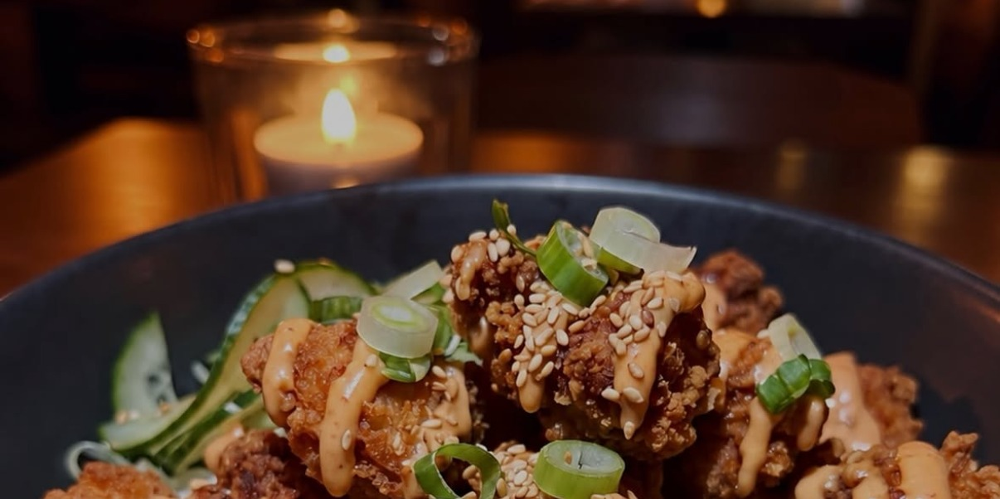

# Crispy Bang Bang Chicken Rice Bowl

*Air-fried crispy chicken thigh on jasmine rice with a creamy Greek yogurt bang bang sauce, cucumber and scallions.*

## Ingredients

### For the bang bang sauce

- ⅓ cup plain nonfat Greek yogurt
- 2 tsp honey
- 1 tsp rice vinegar
- 1 tsp sriracha
- 1 tsp lime juice
- Pinch of salt

### For the bowl

- 8 oz (227 g) raw boneless, skinless chicken thigh
- 2 tbsp cornstarch
- 1 tsp garlic powder
- ½ tsp smoked paprika
- 1 tbsp olive oil
- 1 cup cooked jasmine rice
- ½ cucumber (150 g), thinly sliced
- 2 scallions, sliced
- 1 tsp sesame seeds
- Salt and black pepper, to taste

## Method

1. **Coat the chicken:** Cut the chicken into chunks and pat dry. Toss with cornstarch, garlic powder, paprika, salt and pepper.
2. **Air fry evenly:** Preheat to 400°F (200°C). Brush the chicken with oil and arrange in one layer. Air fry 12–15 minutes, shaking halfway, until crisp and 165°F (74°C) inside.
3. **Mix the sauce:** Whisk the yogurt, honey, vinegar, sriracha, lime juice and salt until smooth.
4. **Prepare the toppings:** Thinly slice the cucumber and scallions. Keep chilled.
5. **Warm the rice:** Heat the cooked rice until steaming hot and spoon into a wide bowl.
6. **Build the bowl:** Add the chicken, drizzle with sauce and scatter over the cucumber, scallions and sesame seeds.

## Notes

Per bowl: about 870 kcal, 60 g protein, 86 g carbs, 33 g fat and 3 g fiber.

**Why it beats the order:** Air frying crisps the coated chicken without deep frying. Greek yogurt adds protein and creaminess to the sauce, and cooking at home lets you choose the oil and seasoning.

---

*Recipe credit: [@eatinghealthytoday on Instagram](https://www.instagram.com/p/DemPTyKjjL4/?img_index=3).*
