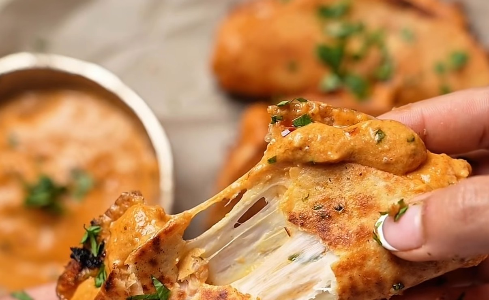

# Butter Chicken Tacos

*Crispy, cheesy tacos filled with creamy butter chicken, griddled with mozzarella until golden and folded in half.*

## Ingredients

### For the chicken

- 250 g chicken breast or boneless chicken thigh
- Salt, to taste
- ½ tsp red chili powder
- ½ tsp cumin powder
- 1 tsp ginger garlic paste

### For the butter chicken sauce

- 2 tbsp butter
- ½ medium onion, roughly sliced
- ¼ cup cashews
- 1 large tomato, diced
- Salt, to taste
- ½ tsp red chili powder
- ½ tsp sugar

### To finish the sauce

- 3 tbsp butter
- ¼ tsp kashmiri red chili powder
- ⅛ cup heavy cream
- Pinch of kasuri methi (optional)
- Chopped cilantro, for garnish

### For the tacos

- Taco shells or small tortillas
- Mozzarella cheese, as much as desired
- 2–3 tbsp butter chicken per taco
- 4 tbsp oil (for crisping)

## Method

### Make the chicken

1. Marinate the chicken with salt, red chili powder, cumin powder and ginger garlic paste. Mix well and set aside.
2. Heat a little oil in a pan and cook the chicken until golden and cooked through. Set aside.

### Make the butter chicken sauce

1. In a separate pan, melt 2 tbsp butter. Add the onion, cashews, tomato, salt, red chili powder and sugar.
2. Cook over medium heat until the onion and tomato have softened.
3. Allow the mixture to cool slightly, then blend into a smooth paste.

### Finish the butter chicken

1. In the same pan, melt 3 tbsp butter and add the kashmiri red chili powder. Stir for a few seconds.
2. Pour in the blended sauce and let it simmer for 1–2 minutes.
3. Add the cooked chicken and mix well.
4. Stir in the heavy cream and kasuri methi, if using.
5. Garnish with chopped cilantro.

### Assemble the tacos

1. Heat 4 tbsp oil in a pan.
2. Place the taco shell or tortilla in the pan and add mozzarella cheese.
3. Spoon 2–3 tbsp of the butter chicken mixture over the cheese.
4. Cook until the bottom is crispy and golden, then fold in half.

---

*Recipe credit: @noor.baqtiar on Instagram.*
