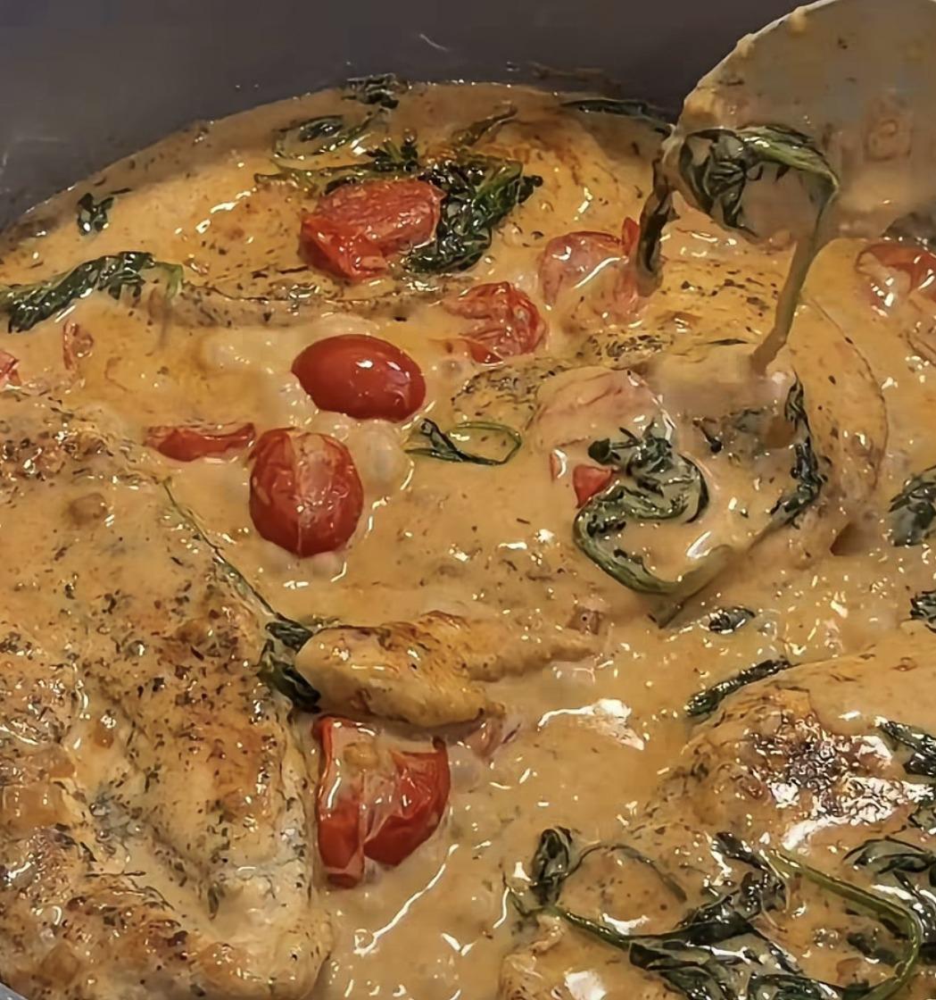

# Creamy Tuscan Chicken

*Golden chicken in a creamy sauce with tomatoes, spinach and Parmesan.*

## Ingredients

### Chicken

- 3 chicken breasts, sliced in half
- Salt and pepper
- ½ tsp smoked paprika
- 1 tsp garlic powder
- 1 tbsp Italian seasoning
- 1 tsp dried parsley
- ½ tsp chili flakes (optional)

### Sauce

- 1 tbsp butter
- ½ onion, diced
- 3 garlic cloves, minced
- 1 cup grape tomatoes, halved
- 2 cups spinach
- 1 cup heavy cream
- ¼ cup Parmesan
- Salt and pepper
- Fresh parsley

## Method

1. Season and cook the chicken until golden; set aside.
2. Sauté the onion and garlic in butter.
3. Add the tomatoes, then the spinach.
4. Stir in the heavy cream and Parmesan until creamy.
5. Season with salt and pepper, return the chicken to the pan, simmer for 2–3 minutes, garnish with parsley, and enjoy!

---

*Recipe credit: @cinthiajgalvez on Instagram.*
