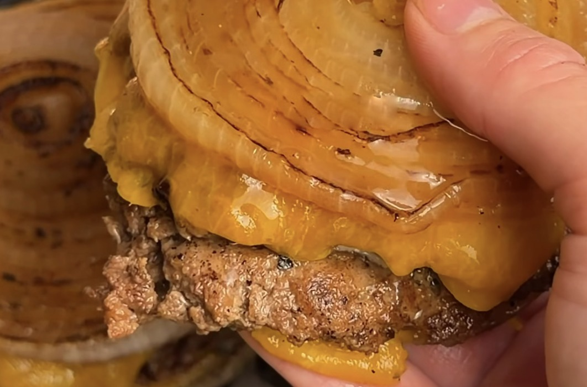

# Flying Dutchman

*A lighter take on the viral In-N-Out burger, with lean beef and melted cheddar between two grilled onion slices instead of a bun.*

## Ingredients

### Burgers

- 1 lb 93% lean ground beef
- 3 large white or yellow onions (you may need extra to get enough thick middle slices)
- Low fat cheddar cheese slices
- Butter for frying (lighter than oil)
- Salt and pepper

### Light burger sauce

- ½ cup light mayo
- 2 tbsp ketchup
- 1–2 tbsp mustard
- Finely diced pickles
- 1–2 tbsp pickle juice, depending on how thick you want it

## Method

1. Cut thick rounds from the middle of your onions to make your onion buns.
2. Form your beef into balls, season, and place on a hot skillet. Press flat and add salt and pepper. Let it cook until it looks almost cooked all the way through, then flip.
3. Add American cheese and let it melt.
4. Fry your onion slices in butter until golden and tender.
5. Sandwich your cheesy burger patties between the onion slices, add your light burger sauce, and dig in!

---

*Recipe credit: [@restorativefoodie on Instagram](https://www.instagram.com/reel/DezambwRnOe/).*
