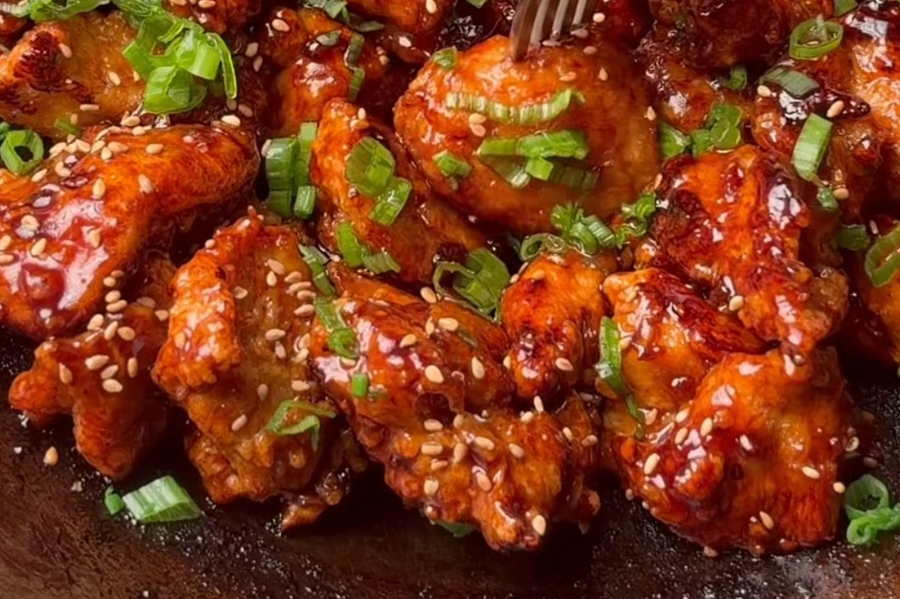

# Honey Garlic Chicken

*Crispy air-fried chicken pieces cooked in a sticky honey garlic soy glaze and finished with sesame seeds and green onions.*

## Ingredients

### For the chicken

- Chicken breast
- Soy sauce
- Black pepper
- 1 Egg
- Cornstarch

### For the glaze

- Butter
- Soy sauce
- Garlic
- Sesame seeds
- Green onions
- Honey
- Water

## Method

1. Mix the chicken breast pieces with soy sauce, black pepper and egg. Refrigerate in 15 min.
2. Add the cornstarch to the mix. Cook the chicken in the air fryer. (The original fries it in oil.)
3. Cook the air-fried chicken pieces in butter, soy sauce, garlic, sesame seeds, green onions, honey and water.

## Notes

Amounts and cooking times are still to be added.

---

*Recipe credit: @ifoodwithu on Instagram.*
