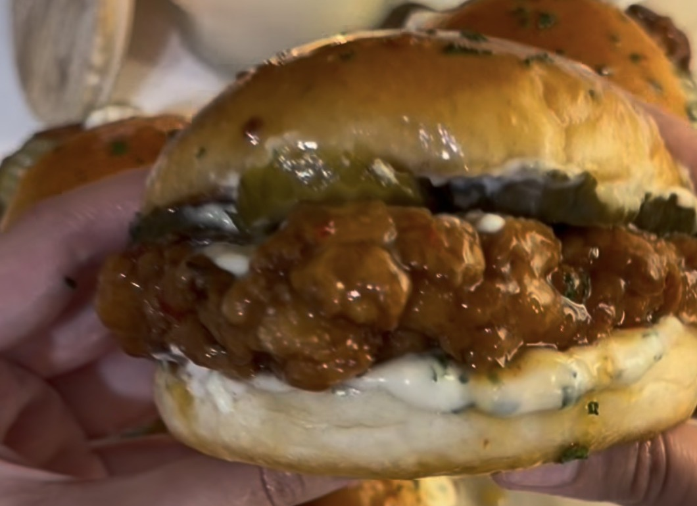

# Hot Honey Crispy Chicken Burgers

*Yogurt-marinated crispy chicken glazed in hot honey butter, with garlic yogurt sauce and pickles.*

## Ingredients

### For the chicken

- 500 g chicken, cut into thin burger-sized pieces
- 200 g Greek yogurt
- 1 tbsp white vinegar
- 2 tbsp hot sauce (optional)
- 1 egg
- 1 tbsp paprika
- 1 tsp black pepper
- 1 tbsp garlic powder
- 1 tsp onion powder
- Pinch of salt

### For the dry coating

- 1 cup chickpea flour
- 1 cup cornflour
- Same seasonings as the chicken

### For the garlic yogurt sauce

- 150 g Greek yogurt
- 2 tbsp water
- 1 tsp garlic powder
- ½ tsp onion powder
- ½ tsp black pepper
- Pinch of salt
- 1 tbsp freshly chopped parsley
- Squeeze of lemon juice

### For the hot honey glaze

- 6–7 tbsp butter
- 1 tbsp oil
- 2 tbsp hot sauce (optional)
- 3 tbsp honey

### For assembly

- 4 burger buns (or sourdough bread)
- Pickles
- 2 onions

## Method

1. **Marinate:** Mix the Greek yogurt, vinegar, hot sauce, egg and chicken seasonings. Add the chicken and marinate for 30–40 minutes.
2. **Coat:** Mix the chickpea flour, cornflour and seasonings. Coat each chicken piece in the flour mixture, dip back into the marinade, then coat in the flour again.
3. **Fry:** Deep-fry (or shallow-fry) immediately in hot oil until golden, crispy and cooked through.
4. **Hot honey glaze:** Melt the butter with the oil, then mix in the hot sauce and honey. Reserve some for the buns and coat the crispy chicken with the rest.
5. **Sauce:** Mix all the sauce ingredients until smooth.
6. **Assemble:** Spread garlic yogurt sauce on the buns, add the crispy chicken and pickles, then close the burgers. Brush the tops with the reserved hot honey glaze and serve with extra sauce. Fry onion rings as decoration.
