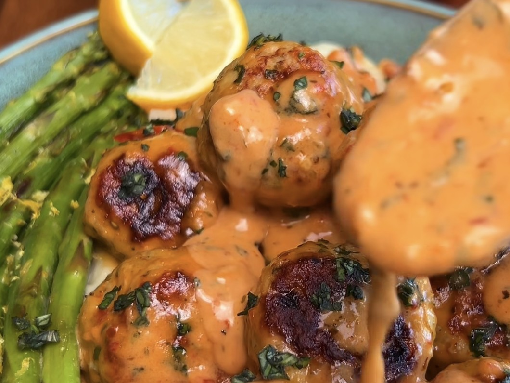

# Marry Me Chicken Meatballs with Garlic Mashed Potatoes & Sautéed Lemon Asparagus

*Italian seasoned chicken meatballs tossed in a creamy garlic-parmesan sauce with sun-dried tomatoes and fresh basil, served with garlic mashed potatoes and sautéed lemon asparagus.*

## Ingredients

### Garlic mashed potatoes

- 2 lb Yukon gold potatoes, peeled and diced
- 3 garlic cloves, minced
- ¼ cup butter
- ¾ cup milk of choice
- ¼ tsp + ⅛ tsp salt (plus extra for boiling the potatoes)
- Cracked black pepper, to taste

### Sautéed lemon asparagus

- 1 bundle of asparagus
- Olive oil
- Salt
- Cracked black pepper
- Lemon zest

## Method

### Garlic mashed potatoes

1. Add the potatoes to a pot of cold water with a handful of salt. Cover and bring to a boil. Boil for 15–20 minutes or until the potatoes are tender.
2. Heat the butter, milk and minced garlic together in a small pot over medium-low until the butter melts and it's warm throughout.
3. Transfer the cooked potatoes to a large bowl and mash with a potato masher. Add the milk and butter mixture, salt and cracked pepper to taste. Continue mashing and mixing until smooth. (You can also use a handheld mixer to whip the potatoes.)
4. Taste and adjust the seasonings, if needed.

### Sautéed lemon asparagus

1. Add a splash of olive oil to a large skillet and heat over medium heat. Once hot, add the asparagus and sauté for 5–8 minutes or until just tender.
2. Generously season with salt and pepper. Sprinkle lemon zest over the top and toss. (Sometimes we'll add a squeeze of lemon too!)

## Notes

The post only lists the recipes for the two sides. The author sends the meatball and sauce recipe by DM when you comment "Meatball" on the post.

---

*Recipe credit: @kalefornia_kravings on Instagram.*
