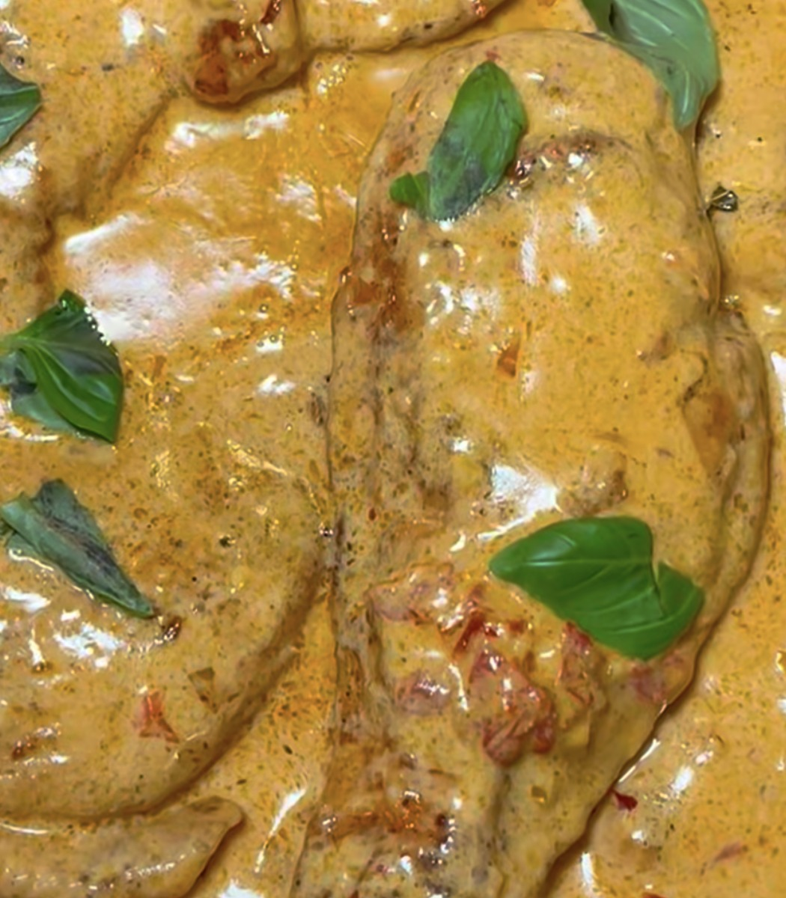

# Marry Me Chicken

*Golden chicken cutlets in a creamy sun-dried tomato and Parmesan sauce.*

## Ingredients

- 3 large boneless, skinless chicken breasts, or 6 chicken cutlets (about 2½ pounds total), patted dry
- Kosher salt (such as Diamond Crystal) and black pepper
- ¼ cup all-purpose flour
- 3 tablespoons extra-virgin olive oil, plus more as needed
- 3 tablespoons unsalted butter
- 3 garlic cloves, chopped
- 1 tablespoon tomato paste
- 1 teaspoon dried oregano
- Red-pepper flakes, to taste
- 1 cup low-sodium chicken stock
- ½ to ¾ cup heavy cream
- ½ cup (1½ ounces) grated Parmesan
- ⅓ cup sliced sun-dried tomatoes, packed in oil
- ½ tablespoon chicken bouillon (optional, this is my modification)
- Fresh basil, for serving

## Method

1. Slice each chicken breast in half horizontally.
2. Season both sides of the chicken with salt and pepper.
3. Coat the chicken with flour and shake off the excess. Transfer the chicken to a plate.
4. Heat the oil in a large pan over medium-high. Once hot, reduce the heat to medium and add the butter.
5. As soon as it melts, add the chicken and cook until golden, about 5 minutes each side. Flip the chicken and cook the other side until golden, 4–5 minutes. Do this in batches, adding more oil if needed. Transfer the cutlets to a plate.
6. Reduce the heat to low, add the garlic and cook until fragrant, 1 to 2 minutes. Add the tomato paste, stirring until the color deepens, about 2 minutes. Add the oregano and red-pepper flakes, to taste.
7. Increase the heat to medium, add the stock and bring to a simmer, scraping up any bits from the bottom of the pan, about 5 minutes.
8. Add the cream, stirring, until it thickens slightly, about 3 minutes.
9. Watch the cream closely, reducing the heat if necessary, to maintain a gentle simmer. Stir in the Parmesan and the sun-dried tomatoes. Add more cream, if you like, and season the sauce. This is where I like to add the chicken bouillon. It is optional, but it really adds a lot more flavor.
10. Place the chicken back in the pan to warm through, about 4 minutes. Remove from the heat and scatter basil on top. Serve with your favorite sides.

## Notes

I served mine on a bed of butter noodles.

---

*Recipe credit: @moniquerubalcava1 on Instagram, from the New York Times 50 Most Popular Recipes of All Time.*
