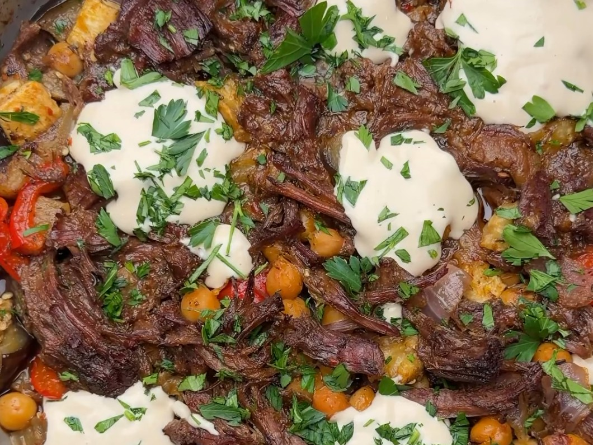

# Mediterranean Beef Shawarma Chuck Roast

*A one-dish slow-roasted shredded chuck roast with eggplant, peppers and chickpeas, finished with garlicky tahini yogurt sauce, parsley and lemon.*

## Ingredients

### For the beef

- 2 lb (900 g) chuck roast
- Salt and pepper
- 1 tbsp smoked paprika
- 1 tbsp garlic powder
- 1 tbsp Aleppo pepper
- 1 tbsp thyme (or oregano)
- ½ tbsp ground cumin
- ½ tsp cinnamon
- 6 garlic cloves
- 24 oz (700 ml) bone broth

### Veggies

- 1 medium eggplant
- 1 medium red onion
- 1 medium red bell pepper
- 1 can (15 oz / 425 g) chickpeas
- Salt and pepper

### Garlicky tahini sauce

- ½ cup plain Greek yogurt
- 2 tbsp tahini
- Juice of ½ lemon
- 1 garlic clove, finely grated
- Pinch of salt
- 1–2 tbsp water

### To serve

- Fresh parsley
- Aleppo pepper
- Lemon juice

## Method

1. Preheat the oven to 350°F (175°C). Grab an oven-safe dish with a lid and place the chuck roast at the base.
2. Season generously on both sides with salt, pepper and all the spices listed above.
3. Toss in the garlic cloves, pour in the 24 oz bone broth, cover, and pop it into the oven at 350°F (175°C) for 3 hours.
4. While that's going, cut the veggies and drain and rinse the chickpeas.
5. Remove the beef from the oven and shred it with 2 forks. Toss in the veggies and chickpeas, mix well, and put it back in the oven covered at 400°F (200°C) for 40 minutes. Then remove the lid and cook another 10–15 minutes so the vegetables get tender and everything gets a little color.
6. For the sauce, mix the Greek yogurt, tahini, lemon juice, garlic and salt. Add a little water until it's creamy and drizzleable.
7. Top everything with fresh parsley, the garlicky tahini yogurt sauce, Aleppo pepper and lemon juice.

## Notes

5 minutes of prep, and it all cooks in one dish.

---

*Recipe credit: @shredhappens on Instagram.*
