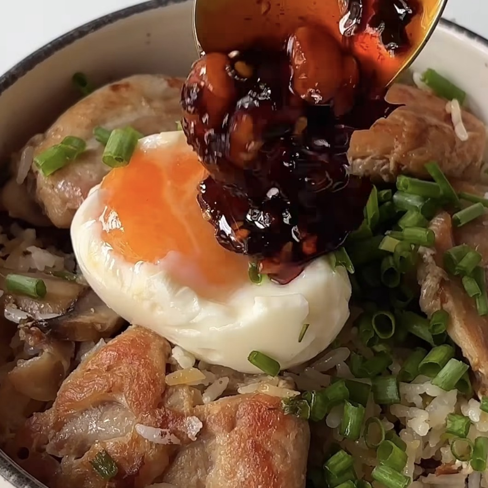

# One Pot (No Oil) Chicken and Mushroom Rice Bowl

*Chicken thighs, mushrooms and short grain rice cooked together in one pan without added oil, with a crispy rice bottom, a soft-boiled egg and chilli oil.*

## Ingredients

### For the rice bowl

- 500 g boneless chicken thighs
- 100 g button mushrooms, sliced
- 1 inch (2.5 cm) ginger, grated
- Handful of green onions
- 1 cup short grain rice, soaked
- Chicken salt or regular salt (chicken bouillon works too)

### To serve

- Soft-boiled egg
- Chilli oil (garnish)

## Method

1. Heat a non-stick pan and cook the chicken thigh pieces on low heat until the bottom turns golden and crispy and the chicken is 80% cooked.
2. In the remaining chicken oil, sauté the ginger and green onion with a pinch of salt for a minute.
3. Add the soaked rice with 1.5 cups of water (add more if needed).
4. Season with chicken bouillon or chicken salt and add the sliced mushrooms and the chicken.
5. Cook covered on the lowest heat for 15 to 20 minutes, until the rice is completely cooked and creates a crispy bottom.
6. Serve with a soft-boiled egg and chilli oil.

---

*Recipe credit: @polosjunkjournal on Instagram.*
