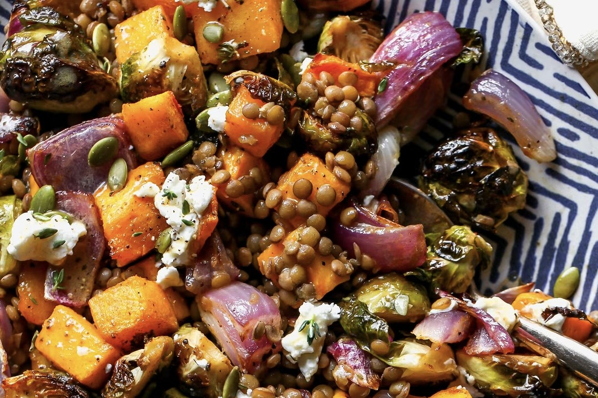

# Roasted Veggie Lentil Salad with Maple-Mustard Dressing

*Roasted Brussels sprouts, butternut squash and red onion with lentils, creamy pockets of goat cheese and a maple-mustard dressing.*

## Ingredients

### For the salad

- 1 cup brown or green lentils
- 2 garlic cloves
- 1 bay leaf
- 1 lb Brussels sprouts
- 4 cups peeled and cubed butternut squash
- 1 small (or ½ large) red onion
- 5 to 6 sprigs fresh thyme
- 3 tbsp extra-virgin olive oil
- 1 tsp ground coriander
- ½ tsp paprika
- 2 to 4 oz goat cheese
- ¼ cup toasted pumpkin seeds

### Maple-mustard dressing

- 2 tbsp apple cider vinegar
- 1 tbsp maple syrup
- 1 tbsp Dijon mustard
- ¼ cup extra-virgin olive oil
- Kosher salt and cracked black pepper

## Notes

Sturdy enough to hold up for make-ahead meals, and versatile enough to enjoy as a main or side.

The post lists ingredients only. The author sends the full method by DM when you comment "Full recipe" on the post.

---

*Recipe credit: @dishingouthealth on Instagram.*
