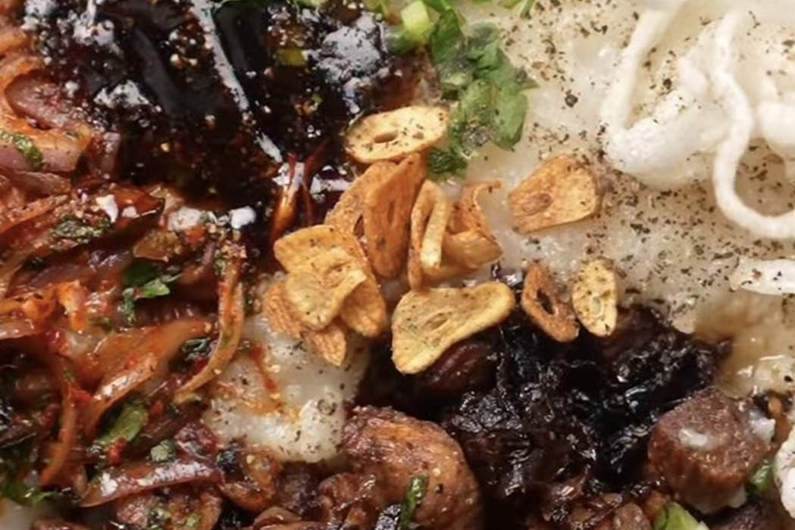

# Sanpiau

*Soupy rice from Mizoram, topped with soy sauce chicken, spicy onions, crisp rice noodles and herbs.*

## Ingredients

### Rice base

- 250 g rice, soaked for 2–3 hours
- 1.5 litres water, plus extra boiling water
- Chicken bouillon cubes or chicken stock, as needed
- Salt, to taste

### Soy sauce chicken

- 250 g boneless chicken, cubed
- 4–5 garlic cloves, chopped
- 1 medium onion, sliced
- 1½ tbsp soy sauce
- Oil, for frying

### Spicy onion topping

- Onion, thinly sliced
- 1 tsp red pepper flakes
- Black peppercorns, freshly roasted and crushed
- Salt, to taste
- Cilantro, chopped
- Hot oil, preferably from frying the chicken

### Other toppings

- Long rice papadums or any rice papad (I used fried rice noodles)
- Green onions, chopped
- Fresh red chillies, thinly sliced
- Cilantro, chopped
- Fish sauce, to taste
- Extra crushed black pepper
- Fried garlic, optional

## Method

1. Soak the rice for 2–3 hours, then drain. Add to a pressure cooker with 1.5 litres water, chicken bouillon (or stock) and salt. Cook for 3 whistles. Turn off the heat and let the pressure release naturally.
2. Open the cooker and whisk or stir the rice to break down the grains. Add boiling water as needed and cook on low, stirring often, until the rice is completely soft, mushy and soupy. Adjust salt and keep warm.
3. Heat oil over medium heat. Fry garlic and sliced onion until golden. Add the chicken and fry until golden and cooked through. Pour in the soy sauce, stir well and cook for another 2 minutes. Set aside, reserving some of the oil.
4. Fry rice papad or dried rice noodles until crisp. In a dry pan, roast whole black peppercorns until fragrant, then crush them coarsely.
5. Mix sliced onion, red pepper flakes, salt and freshly crushed pepper. Pour over a little hot oil or reserved chicken oil, toss well, then add chopped cilantro.
6. Spoon the hot, soupy rice into a bowl. Top with soy sauce chicken, spicy onions, crisp papad or rice noodles, green onions, cilantro and red chillies. Finish with crushed black pepper, fish sauce and optional fried garlic. Serve hot!

---

*Recipe credit: [@noor.baqtiar on Instagram](https://www.instagram.com/reel/DeyAZuNv7IU/), India on My Plate episode 5.*
