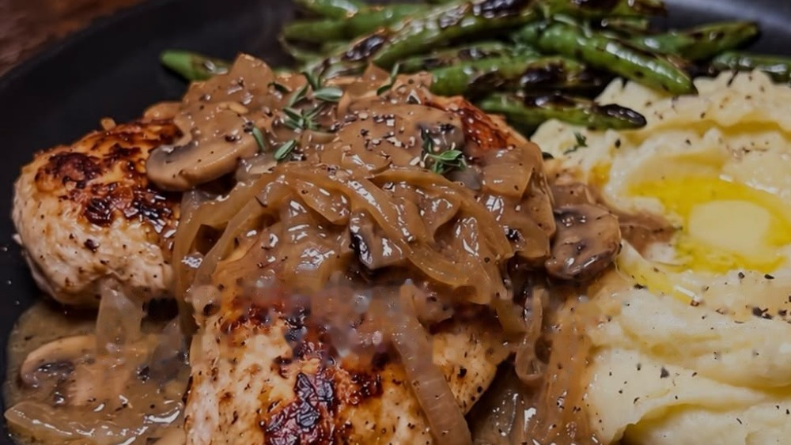

# Smothered Chicken with Buttery Mash and Green Beans

*Seared chicken cutlets smothered in a mushroom and onion gravy, served with Greek yogurt mash and blistered green beans.*

## Ingredients

### For the mushroom gravy

- 1 cup chicken stock
- 2 tsp cornstarch
- 1 medium onion (150 g), thinly sliced
- 4 oz (113 g) mushrooms, sliced
- 2 sprigs fresh thyme
- 1 tsp olive oil
- Salt and black pepper, to taste

### For the plate

- 6 oz (170 g) raw boneless, skinless chicken breast
- 8 oz (227 g) potatoes, peeled and cubed
- 3 tbsp plain nonfat Greek yogurt
- 1 tsp butter
- 2 tsp olive oil
- 1 cup green beans, trimmed
- ½ tsp garlic powder
- ½ tsp smoked paprika
- Fresh thyme, to finish

## Method

1. **Start the potatoes:** Boil the potatoes in salted water for 15–20 minutes until tender. Drain and let them steam dry.
2. **Sear the chicken:** Halve the breast into thin cutlets and season with garlic powder, paprika, salt and pepper. Brown in 2 tsp oil over medium-high heat, about 3 minutes per side. Transfer to a plate.
3. **Cook the vegetables:** Add the remaining 1 tsp oil, the onion and the mushrooms. Cook for 6–8 minutes until softened and lightly browned.
4. **Finish the gravy:** Whisk the cornstarch into the cold stock. Add it with the thyme and simmer until thickened. Return the chicken and simmer about 5 minutes, until 165°F (74°C) inside.
5. **Make the sides:** Mash the potatoes with the yogurt and butter. Steam the beans in a skillet with a splash of water until tender-crisp, then evaporate the water and lightly blister them.
6. **Plate the meal:** Remove the thyme stems. Serve the chicken and gravy with the mash and beans and finish with fresh thyme.

## Notes

Per plate: about 730 kcal, 60 g protein, 73 g carbs, 23 g fat and 11 g fiber.

**Why it beats the order:** Cornstarch thickens the gravy without cream. Greek yogurt makes the mash creamy, with a little butter for flavor.

---

*Recipe credit: [@eatinghealthytoday on Instagram](https://www.instagram.com/p/DemPTyKjjL4/?img_index=5).*
