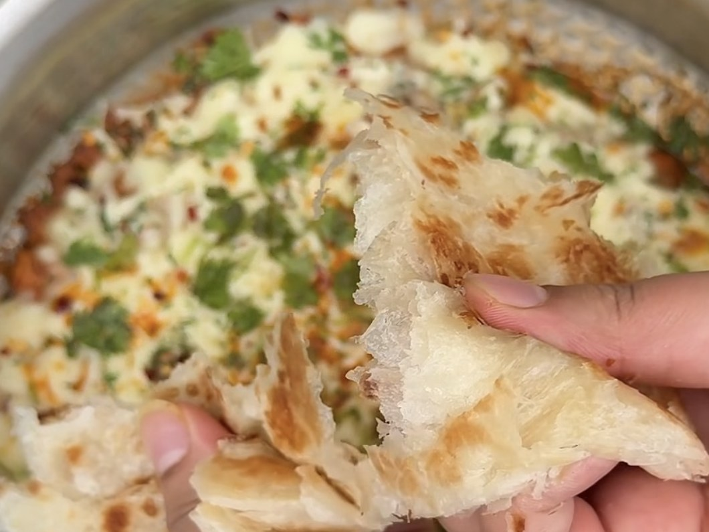

# Turkish Chicken

*Creamy, cheesy, melt-in-your-mouth chicken in a white sauce. Quick, and perfect for unexpected guests.*

## Ingredients

### Chicken

- 1 kg boneless chicken (5 pieces)
- 200 g dahi (yogurt)
- 1 tsp salt, or to taste
- 1 tsp red chilli powder
- 1 tsp black pepper powder
- 1 tsp cumin (jeera) powder
- 2 tsp paprika powder
- 2 tbsp tomato paste
- 2–3 tbsp ginger & garlic paste
- 1 lemon
- 2–3 cubes of butter, for cooking

### White sauce

- 3–4 cubes of butter
- 3 tbsp maida (all-purpose flour)
- 1 cup milk
- 1 tsp garlic granules
- ½ tsp salt
- ½ tsp chilli flakes
- ½ tsp black pepper powder
- ½ tsp oregano
- 1 tsp parsley

### To finish

- Mozzarella
- Parmesan
- Fresh parsley
- A little chilli flakes

### To serve

- Toasted bread, pita, rice, crispy fries or laacha paratha

## Method

### Chicken

1. Mix the chicken with the dahi, salt, red chilli powder, black pepper, cumin, paprika, tomato paste, ginger & garlic paste and the juice of the lemon. Mix well, cover and leave for 20–30 minutes for better flavour.
2. Melt 2–3 cubes of butter in a pan, add the chicken and cook for 15–20 minutes on low-high heat.

### White sauce

1. Melt 3–4 cubes of butter, add the maida and stir for 2–3 minutes on low-high heat.
2. Add the milk and stir well. Add the garlic granules, salt, chilli flakes, black pepper, oregano and parsley, and mix until smooth.

### Finish

1. Pour the white sauce over the chicken.
2. Add mozzarella and Parmesan, finish with fresh parsley and a little chilli flakes, and cook for only 4–5 minutes.
3. Serve hot with toasted bread, pita, rice, crispy fries or laacha paratha.

## Notes

The post gives no amounts for the mozzarella and Parmesan. Add them to taste.

---

*Recipe credit: @waheiba_cooking on Instagram.*
